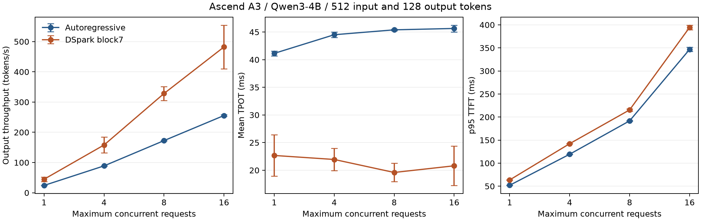

# vLLM-Ascend Serving Lab

[](https://github.com/52Xayah/vllm-ascend-serving-lab/actions/workflows/ci.yml)

**大模型推理部署与性能分析 · 昇腾 A3 · vLLM-Ascend · Qwen3-4B**

将双实例部署的手工流程做成可配置、可测试的 Shell 工具，并在同一颗 Ascend910 上完成 **16 轮普通解码与 DSpark 对照**。在并发上限 1、4、8、16 下，DSpark 将输出吞吐提升 **77.7%–90.3%**，平均 TPOT 降低 **44.9%–56.8%**，同时提高了 p95 首 token 延迟。

## 项目贡献

| 工作 | 实现与验证 |
| --- | --- |
| **双实例部署工程化** | 将共享配置和实例配置分离，分别绑定 NPU 与端口，让在线实例准备权重、离线实例复用缓存。使用 Bash 数组组装命令，解决手工部署中的参数截断。补齐 dry-run、端口检查、就绪探测、后台日志和停止入口。 |
| **设计并执行单 NPU 对照实验** | 两种解码模式使用同一主模型、设备和服务参数，按「普通 → DSpark → DSpark → 普通」独立启动。每轮固定 512 输入 token、128 输出 token，覆盖四档并发，共完成 **384 个请求、49,152 个输出 token**。 |
| **从推理原理解释性能差异** | 通过 vLLM 记录草稿接受长度，用 Ascend Profiler 核对 kernel 执行，结合服务日志比较可用 KV Cache 预算。将吞吐、首 token 延迟和缓存开销同时纳入结果。 |
| **建立无 NPU 的验证流程** | 编写 16 项测试覆盖 dry-run、参数组装和非法配置拒绝。GitHub Actions 运行 ShellCheck、Bash 语法检查和脚本测试。 |

[部署脚本](scripts/) · [实验报告与复现命令](docs/experiments/2026-11-23-dspark-a3/README.md) · [逐轮数据](docs/experiments/2026-11-23-dspark-a3/trials-rounded.csv) · [Profiler 指标](docs/experiments/2026-11-23-dspark-a3/profile-summary.csv)

## 昇腾 A3 实测

| 并发上限 | 输出吞吐（token/s） | 吞吐增幅 | 平均 TPOT（ms） | p95 TTFT（ms） |
| ---: | ---: | ---: | ---: | ---: |
| 1 | 24.27 → 44.68 | +84.1% | 41.14 → 22.68 | 51.99 → 63.53 |
| 4 | 88.89 → 157.99 | +77.7% | 44.51 → 21.95 | 119.30 → 142.18 |
| 8 | 172.48 → 328.23 | **+90.3%** | 45.39 → 19.60 | 191.71 → 215.50 |
| 16 | 255.46 → 482.26 | +88.8% | 45.65 → 20.81 | 346.74 → 394.47 |

箭头表示普通解码到 DSpark。每项取两次独立启动所对应的两轮指标的中位数。TPOT 衡量首 token 之后的平均单 token 耗时，TTFT 衡量首 token 延迟。



### 为什么输出更快

普通自回归解码每轮推进一个 token。DSpark block7 每轮最多提议 7 个草稿 token，由目标模型验证候选序列。本次测得平均接受长度为 **2.60–2.97 token/轮**，按 vLLM 口径包含目标模型输出的一个 token。每轮推进更多 token，可以摊薄串行解码成本，最终收益还取决于草稿生成与目标验证的开销。

对同一条生成 32 个 token 的贪心请求单独采样，两种模式输出文本一致。Profiler 记录的 NPU kernel 从 **14,738 降到 10,632**，其中 `FusedInferAttentionScore` 从 **1,152 次降到 574 次**。这为算子执行量减少提供了证据。时间线缺少草稿生成与目标验证的独立标注，无法精确拆分两段耗时。

### 代价和适用范围

四档并发下 p95 TTFT 都升高。设备内存利用率参数固定为 0.8 时，启动日志中的可用 KV Cache 内存从 **41.13 GiB 降到 38.38 GiB**。实验采用固定长度的合成请求，每档并发只有两轮，结论适用于本次模型、硬件与负载。现有数据还无法定位 TTFT 上升来自哪个阶段。

## 双实例部署

两个部署配置均运行 Qwen3-4B + DSpark，共用模型缓存。单 NPU 性能实验通过 [实验报告里的 vLLM CLI 命令](docs/experiments/2026-11-23-dspark-a3/README.md#复现参数)依次启动普通解码与 DSpark。

| 实例 | 可见设备 | 服务端口 | 权重加载 |
| --- | --- | ---: | --- |
| [a](configs/instances/a.env) | `ASCEND_RT_VISIBLE_DEVICES=0` | 8000 | 在线，首次下载主模型与草稿权重 |
| [b](configs/instances/b.env) | `ASCEND_RT_VISIBLE_DEVICES=1` | 8001 | 离线，复用 a 准备好的 `HF_HOME` |

实机启动需要有 Ascend NPU 的 Linux 环境、与镜像匹配的 CANN、ATB 和 vLLM-Ascend，以及 Bash 和 curl。运行 `npu-smi info` 确认设备编号，并核对[公共配置](configs/common.env)中的环境脚本、Python 和模型缓存路径。

```bash
bash scripts/serve.sh a --dry-run
bash scripts/serve.sh a --background
bash scripts/health_check.sh a
bash scripts/stop.sh a

# 无需 NPU 的脚本测试
bash tests/test_scripts.sh
```

后台日志位于 `logs/a.log`，PID 记录位于 `run/a.pid`。原课程手工流程有双实例并行验证记录。仓库 Shell 入口的并行启动、离线缓存复用和后台启停仍待真机端到端回归。 [原课程流程](docs/legacy-guide.md)

## 复现与数据

[实验报告](docs/experiments/2026-11-23-dspark-a3/README.md)包含镜像版本、源码提交、启动命令、压测参数和 Profiler 采样方法。实验目录随仓库提供性能图、16 轮指标和算子统计。

本地完整归档 `dspark-a3-results-20261123.tar.gz` 包含 311 个文件，包括原始压测 JSON、32 份 Prometheus 快照、两份完整时间线、权重哈希和实际执行脚本。归档的 SHA-256 如下。

```text
45540b1b10b817886b71651d1ccfa08237b289e5feec5b23d0f766e3cbe27daa
```
