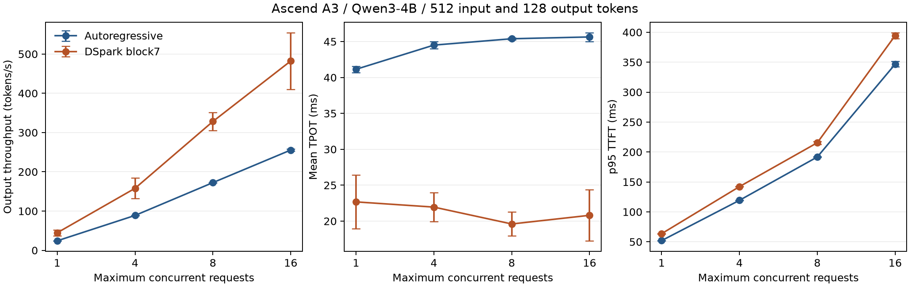

# 昇腾 A3 上的 DSpark 投机解码对照实验

2026 年 11 月 23 日，在 HiDevLab 昇腾 A3 环境上完成。对照使用同一颗 Ascend910（进程内逻辑设备 0）、同一份 Qwen3-4B 主模型与相同的服务参数。实验组启用 DSpark `block7`。共完成 16 轮正式压测、384 个请求和 49,152 个输出 token。另用独立的 Profiler 采样比较两种模式的 NPU 算子执行。

## 结果

| 并发上限 | 普通解码吞吐（token/s） | DSpark 吞吐（token/s） | 吞吐增幅 | 平均 TPOT（ms），普通 → DSpark | p95 TTFT（ms），普通 → DSpark | DSpark 平均接受长度 |
| ---: | ---: | ---: | ---: | ---: | ---: | ---: |
| 1 | 24.27 | 44.68 | +84.1% | 41.14 → 22.68 | 51.99 → 63.53 | 2.60 |
| 4 | 88.89 | 157.99 | +77.7% | 44.51 → 21.95 | 119.30 → 142.18 | 2.69 |
| 8 | 172.48 | 328.23 | +90.3% | 45.39 → 19.60 | 191.71 → 215.50 | 2.97 |
| 16 | 255.46 | 482.26 | +88.8% | 45.65 → 20.81 | 346.74 → 394.47 | 2.97 |



每个点取两轮指标的中位数。图中的竖线表示两轮实测范围。TPOT 是首 token 之后的平均单 token 耗时。p95 TTFT 先按每轮 24 个请求计算，再取两轮的中位数。[逐轮数据（四舍五入）](trials-rounded.csv)

## 实验设计

- **环境**为 HiDevLab vLLM-Ascend 0.30.0 镜像。运行时为 vLLM 0.30.0+empty 与 vLLM-Ascend 0.30.0。主模型为 `Qwen/Qwen3-4B`，草稿为 `deepseek-ai/dspark_qwen3_4b_block7`，权重从 ModelScope 下载后从本地目录加载。
- **固定服务配置**为 BF16、TP=1、eager 模式、最大上下文 2048、最大同时调度序列数 16、批次 token 上限 4096、设备内存利用率参数 0.8、关闭异步调度及 prefix caching。客户端在同一台机器上访问回环地址。
- **顺序**为「普通 → DSpark → DSpark → 普通」，每次独立启动服务并预热 8 个请求。前两次按并发 1、4、8、16 扫描，压测种子为 42，后两次反向扫描，种子为 43。同一组内两种模式使用相同的种子与并发顺序。
- **负载**为每轮 24 条固定 512 输入 token、128 输出 token 的合成请求，设置 `--ignore-eos`，在固定客户端并发上限下持续发送。DSpark 接受指标取自 vLLM 压测内部采样窗口，单独的预热和初始探测请求不计入该窗口。

## 底层证据与边界

1. **每轮验证可以推进多个 token。** 配置允许提出最多 7 个草稿 token。表中的平均接受长度按 vLLM 口径计算为 `1 + 接受的草稿 token 数 / 草稿轮数`。每轮实际推进的 token 数与单轮执行成本共同决定 TPOT。这里观察到 TPOT 降低，但 TTFT 升高。现有数据无法精确归因首 token 延迟差异。
2. **时间线记录到更少的 kernel。** 对同一条 11 输入 token、32 输出 token 的贪心请求，两种模式返回文本一致。NPU kernel 记录由 14,738 降到 10,632，`FusedInferAttentionScore` 由 1,152 次降到 574 次。算子执行时长累计值由 300.68 ms 降到 185.80 ms，累计值可能包含重叠。如果需要精确拆分草稿和目标验证时间，还需增加对应的阶段标注。[Profiler 指标摘录](profile-summary.csv)
3. **内存预算和重复间波动也有影响。** 启动日志中的可用 KV Cache 内存从 41.13 GiB 降到 38.38 GiB。并发 16 下两轮 DSpark 吞吐分别为 409.81 与 554.72 token/s。两组之间请求种子和扫描次序共同变化，无法从这两轮分离各自的影响。实验范围限于该单 NPU、合成请求和所测并发点。

## 复现参数

使用上述 vLLM-Ascend 镜像，将 `TARGET` 和 `DRAFT` 指向已下载的本地模型目录。两个模式在同一颗可见设备上先后执行，每次启动前确认前一个服务已经退出。

```bash
export ASCEND_RT_VISIBLE_DEVICES=0
export HF_HUB_OFFLINE=1 TRANSFORMERS_OFFLINE=1 OMP_NUM_THREADS=1

common=(serve "$TARGET" --host 127.0.0.1 --port 18000
  --served-model-name qwen3-4b-test --tensor-parallel-size 1 --dtype bfloat16
  --max-model-len 2048 --max-num-seqs 16 --max-num-batched-tokens 4096
  --gpu-memory-utilization 0.8 --seed 42 --enforce-eager
  --no-async-scheduling --no-enable-prefix-caching)

# 普通解码
vllm "${common[@]}"

# DSpark，用这个命令单独启动下一轮服务
spec=$(python -c 'import json,sys; print(json.dumps(dict(method="dspark", model=sys.argv[1], num_speculative_tokens=7, enforce_eager=True)))' "$DRAFT")
vllm "${common[@]}" --speculative-config "$spec"
```

在第二个远端终端对每个服务先进行预热（`N=8`、`C=4`、`SEED=7`），再按上述顺序正式测量（`N=24`）。为每轮设置不同的 `RESULT_FILE`。

```bash
vllm bench serve --backend openai --endpoint /v1/completions \
  --base-url http://127.0.0.1:18000 --model qwen3-4b-test --tokenizer "$TARGET" \
  --dataset-name random --random-input-len 512 --random-output-len 128 \
  --random-range-ratio 0 --num-prompts "$N" --request-rate inf \
  --max-concurrency "$C" --ignore-eos --seed "$SEED" \
  --percentile-metrics ttft,tpot,itl,e2el --save-result --save-detailed \
  --result-dir . --result-filename "$RESULT_FILE"
```

从详细结果 JSON 的 `ttfts` 数组计算 p95，再将秒换算为毫秒。单独采集 Profiler，先预热，再用 `/start_profile` 和 `/stop_profile` 包住一次贪心请求，从 `kernel_details.csv` 提取算子计数。采样请求使用提示词 `Complete this passage about how transformers use attention and memory:`，固定 `temperature=0`、`max_tokens=32`、`ignore_eos=true`。[vLLM-Ascend Profiler 指南](https://docs.vllm.ai/projects/ascend/en/main/developer_guide/performance_and_debug/service_profiling_guide.html)

完整原始 JSON、Prometheus 快照、日志、执行脚本及 Profiler 时间线归档于实验环境的 `/workspace/dspark-study-20261123/dspark-a3-results-20261123.tar.gz`。本目录收录公开报告、逐轮指标摘录、性能图和 Profiler 指标摘录。
